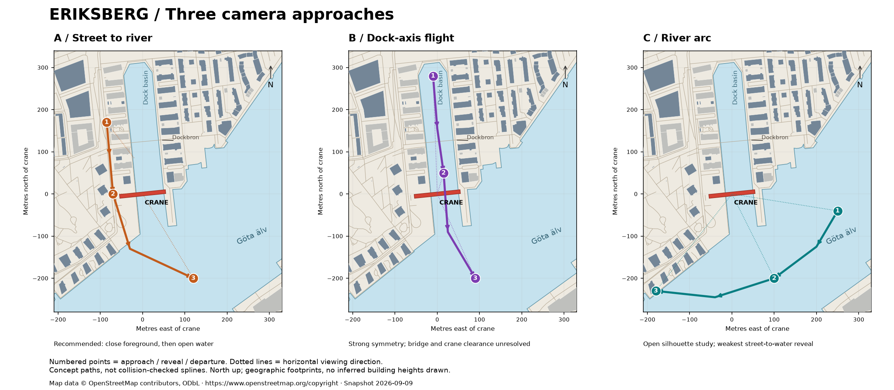

# Eriksberg coverage inspection and camera approaches

Historical survey, 2026-09-09; status reconciled 2026-10-18. The findings, counts,
candidate routes, and proposed next iteration below record the original inspection,
not current runtime coverage. Route A's short/long cuts were implemented and remain in
`waterfront_storyboard`. The main `cube` demo now follows five gulls for four minutes.
See [the renderer guide](../3D.md) and [current plans](../README.md).

The separately sourced [Älvsborgsbron river expansion](bridge/README.md) is implemented
as `boat_study --location river`, including the bridge and road approaches. It preserves
the default Eriksberg scene; its larger assets are bundled alongside it. The default
Eriksberg context has also grown beyond this survey's original crop.

## Recommendation

Start with **A: Monsungatan to the river**. Follow the west side of the dock neighbourhood,
reveal the crane on the left/east side of the flight path, then turn out over Göta älv and
look back. This best matches the agreed street-to-water reveal. The route is a sketch based
on mapped footprints and roads, not yet a collision-checked 3D flight.

[Scalable route map](camera-approaches.svg) · [Coverage map](coverage.png) ·
[Scalable coverage map](coverage.svg) · [Coordinates and counts](survey-summary.json)

## What the downloaded map actually contains

A local Overpass extract was downloaded and retained as [osm-survey.json.gz](osm-survey.json.gz).
Its OSM base timestamp is **2026-09-09T09:33:47Z**. The query covers latitude 57.692–57.704,
longitude 11.900–11.922; returned geometry was limited to a slightly larger box. This is an
inspection snapshot, now also used as the bundled geometry input.

Counts below are calculated from that extract, not estimates of provider-wide coverage:

| Building information | Detailed crop | Surrounding context |
| --- | ---: | ---: |
| Crop size | 440 × 530 m | 950 × 900 m |
| Building features | 84 | 197 |
| Explicit `height` | 15 | 38 |
| `building:levels` | 40 | 61 |
| Either height or levels | 55 (65%) | 99 (50%) |
| Neither | 29 | 98 |
| `roof:shape` | 19 | 37 |

Counts use the centre of each feature's bounding box in the crop. Building relations are
counted once and their member ways are excluded; the crane and features tagged only as
`building:part` are excluded. These are building outlines, including small structures, not
84 city blocks. The crops are nested, so the context count includes the detailed crop.
Tags were checked for presence; their accuracy has not been independently surveyed.

The extract supplies the dock basin and adjacent river bank geometry through water relation
[3329487](https://www.openstreetmap.org/relation/3329487), the west/east dock promenades,
Monsungatan, and Dockbron. Road/path centre lines establish routes, but do not uniformly
supply road widths or kerb geometry. For initial preparation, infer widths by road class and
author the important quay edges explicitly.

The crane is relation [15956173](https://www.openstreetmap.org/relation/15956173), named
“Eriksbergs bockkran”, with `man_made=crane`, `crane:height=80`, and a red metal appearance.
Its mapped centre is approximately **57.6973921 N, 11.9089495 E**. The footprint spans roughly
110 m east–west. This is enough to place a landmark, but extruding the footprint would make
a solid wall. Author the legs, crossbeam, and open space separately. The 80 m tag is a starting
reference, not a verified crossbeam clearance or detailed structural drawing.

Practical conclusion: OSM is sufficient for the first geographic blockout. Convert floor
counts to explicit assumed heights, use deterministic defaults for the 29 missing entries,
and prioritize manual checks for the buildings immediately beside the flight path.

## Terrain and other sources checked

**Göteborg Höjdmodell 2022:** the published specification describes a 0.5 m ground grid in
1 km GeoTIFF tiles, EPSG:3007 with RH 2000 elevations, under CC0. It is derived from ground
points; it is not a rooftop-height dataset. Water areas need separate treatment.
[Product specification](https://opengeodata.goteborg.se/files/hojdmodell/2022/hojdmodell_2022_en.pdf)

I downloaded and inspected the [tile index](terrain-metadata.zip). The detailed crop lies
in `6397_144.tif`; the context crop also intersects `6397_145.tif`, `6398_144.tif`, and
`6398_145.tif`. All are indexed under delivery package `639_14`, listed as approximately
590 MB on the [download page](https://opengeodata.goteborg.se/files/hojdmodell/2022/hojdmodell_2022.html).
The index confirms tile coverage; elevation samples have **not** been downloaded or checked.

**Göteborg Baskarta DWG:** its specification lists 3D mapping, roof outlines, shoreline,
quay structures, and kerbs, under CC0 with no authentication. It could refine the waterfront.
However, the download URL printed in the specification returned **HTTP 404** during this
inspection. Treat it as an optional follow-up, not a dependency for the first blockout.
[Product specification](https://opengeodata.goteborg.se/files/baskarta/baskarta_dwg_v2_sv.pdf)

Overture and Lantmäteriet were not sampled for this crop. We have not established that either
would improve the missing building heights. A ready-to-use open 3D building mesh for this
location has not been verified. The proposed baseline is OSM geometry plus local terrain,
with one authored crane and documented height assumptions.

## Crop and coordinates

Use a local metre frame centred on the crane. The inspected projection is SWEREF 99 12 00,
EPSG:3007; the origin is easting **144570.579**, northing **6397583.370**. The maps show east
and north offsets. At runtime those can become X and Z, with Y reserved for elevation.

| Crop | Local bounds: west, south, east, north (m) | Approximate geographic bounds |
| --- | --- | --- |
| Detailed geometry | −180, −180, +260, +350 | 57.69577–57.70054 N; 11.90594–11.91330 E |
| Context and water | −400, −400, +550, +500 | 57.69380–57.70189 N; 11.90225–11.91816 E |

The local rectangles are authoritative; geographic values are rounded transformed corner
coordinates for orientation. Final query bounds should enclose all four transformed corners
with a margin. Load intersecting geometry, not just feature centres as used in the counts.
The context crop includes part of the opposite bank, so the final frame can have a background
silhouette. It is not a guarantee that all possible camera view cones are covered; extend
background geometry or use a deliberate distance treatment after testing the 3D shot.

## Three approaches

All elevations below are **artistic starting values in metres above local ground/water**,
not surveyed absolute heights. Numbered points correspond to the maps. Intermediate path
points and full longitude/latitude coordinates are retained in `survey-summary.json`.

| Route | Shot 1: approach | Shot 2: reveal | Shot 3: departure |
| --- | --- | --- | --- |
| **A — street to river** | (−85,+170), height 14: follow Monsungatan south, foreground blocks framing the path | (−70,0), height 25: turn the view east toward the crane as the buildings clear | (+120,−200), height 38: glide over water, looking back at the crane and neighbourhood |
| **B — dock-axis flight** | (−10,+280), height 18: align down the basin between the two built-up sides | (+15,+50), height 24: the crane fills the opening ahead | (+90,−200), height 38: emerge into the river and look back |
| **C — river arc** | (+250,−40), height 18: approach the crane obliquely from the water | (+100,−200), height 32: reveal the full crane silhouette with the district behind it | (−180,−230), height 48: arc west and rise along the waterfront |

**A:** strongest contrast between close architecture and open water. The early path follows
mapped Monsungatan vertices approximately, then leaves the street. Check nearby balconies,
roofs, and trees, and the western crane leg as the shot turns. The reveal is a camera turn,
not a flight through the crane structure. The final view keeps the landmark on screen.

**B:** strongest symmetry and most dramatic potential passage beneath the crane. It starts
over the basin, so water is visible immediately. Dockbron crosses the route around 125 m
north of the crane; bridge and crane clearances need authored/surveyed geometry before this
can become a safe path. The crane footprint alone cannot answer those clearance questions.

**C:** simplest broad composition and the clearest silhouette study. It offers little of the
street-to-water surprise and asks for more skyline/background coverage. Useful as a fallback
or as inspiration for the final part of A. Check quay clearance at the western end.

## Timing comparison

Horizontal polyline lengths are approximately **472 m (A), 500 m (B), and 512 m (C)**.
A spline and height changes will alter those lengths slightly.

| Duration | A average horizontal speed | Consequence |
| --- | ---: | --- |
| 15.36 s / two patterns | 30.7 m/s (111 km/h) | Fast demo flight; limited time to read the reveal |
| 30.72 s / four patterns | 15.4 m/s (55 km/h) | More room for foreground, water and landmark to register |

Recommendation: compare a **30.72-second A storyboard** with a shortened two-pattern variant
before settling duration. The full version could give roughly one pattern to approach, one
to reveal, and two to the turn over water. For two patterns, start closer to the crane and
finish nearer the quay instead of simply doubling the camera speed. No timeline or generated
music asset has been changed; a longer slot requires a separate arrangement decision.

## Suggested next iteration

Make a simple flat-shaded 3D storyboard for A, using the retained footprints, explicit height
assumptions, a coarse ground surface, and an open crane proxy. Compare short and long camera
passes. Verify view direction, collision clearance, landmark framing, and shoreline continuity
before investing in textures, reflections, or a production importer.

## Reproducibility and attribution

- `osm-survey.json.gz` is the unmodified Overpass JSON response, gzip-compressed with fixed
  compression timestamp. Its uncompressed SHA-256 is recorded in `survey-summary.json`.
- The query is retained in `overpass-query.txt`; endpoint: `https://overpass-api.de/api/interpreter`.
  Re-running the query fetches newer data; use the retained snapshot to reproduce this survey.
- `terrain-metadata.zip` is the unmodified city tile/coverage index from
  `https://opengeodata.goteborg.se/downloads/hojdmodell/2022/hojdmodell_2022_metadata.zip`.
- The map generator uses the two local river-bank chains and closes them outside the displayed
  crop. This is a planning illustration, not a complete river polygon suitable for importing.
- `survey.py` regenerates the two PNG/SVG maps and counts using matplotlib and pyproj. It does
  not convert geometry into Proteus assets. Libraries used: matplotlib 3.11.1, pyproj 3.8.0;
  pyshp 3.1.6 was used separately to inspect the terrain index.
- OSM data: © OpenStreetMap contributors, licensed under
  [ODbL 1.0](https://opendatacommons.org/licenses/odbl/1-0/).
  [Attribution information](https://www.openstreetmap.org/copyright).
  City terrain metadata: Göteborgs Stad, CC0 per the linked product specification.
